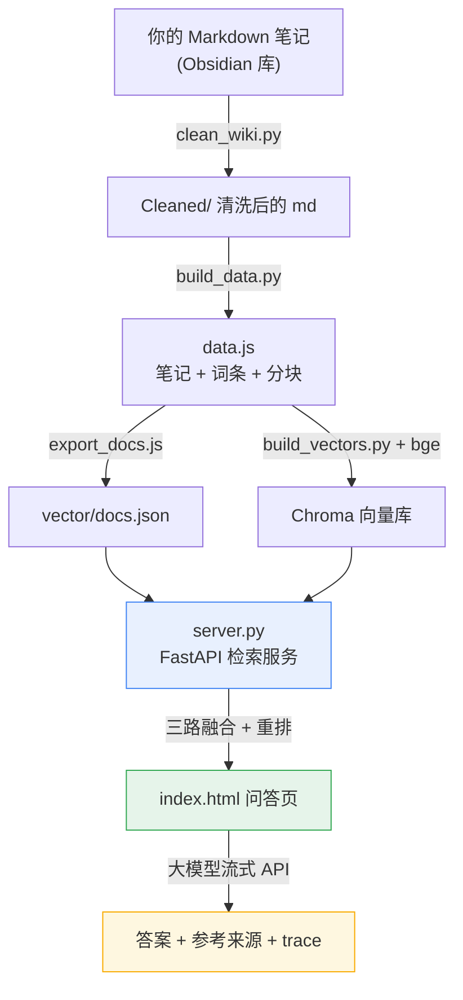
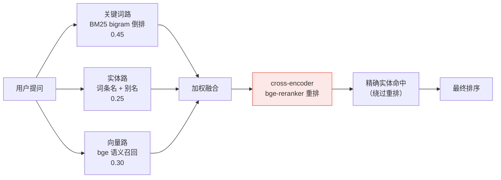

# 使用指南（面向使用者）

> 这份文档给**拿到代码、想把它跑起来用的人**看。
> 假设你已 clone 仓库到本地，还没装任何东西。
> 技术原理、评测方法见 [`检索页/README.md`](./检索页/README.md)。

---

## 一、它能干什么

一个**可以切换多套知识库的智能问答页面**。你把 Markdown 笔记丢进去，它会：

1. 切成小块、建索引（关键词 / 实体别名 / 向量语义三路）
2. 你用自然语言提问 → 它找出最相关的几段原文
3. 交给大模型生成回答，**逐字流式显示**
4. 把「它凭什么答出来的」摊开给你看（参考来源 + 相似度 + 检索过程）

界面上就五样东西：

```
┌────────────────────────────────────────────────────────┐
│  [知识库切换器 ▼]                          [检索自检]    │  ← 顶栏
├────────────────────────────────────────────────────────┤
│  ❓ 输入你的问题...                    [智能 ▼] [提问]  │  ← 提问区
├────────────────────────────────────────────────────────┤
│  ▾ 检索过程  (7 步 · 128ms)                             │  ← 可解释面板
│     1 分词 → 2 关键词路 → 3 实体路 → 4 融合             │
│     → 5 闸门 → 6 取料 → 7 生成                          │
├────────────────────────────────────────────────────────┤
│  答案区（流式输出）                                     │
│  ── 参考来源 ──────────────────────────                 │
│  · 《2026世界杯完整分组表》        87%                  │
│  · 《梅西》             实体       72%                  │
└────────────────────────────────────────────────────────┘
```

---

## 二、整体链路（一图看懂）



**三路融合**是它的核心：



---

## 三、环境准备

| 依赖 | 版本 | 用途 |
|---|---|---|
| Python | 3.11+ | 服务端检索、模型推理 |
| Node.js | 18+ | 前端构建、评测脚本 |
| 磁盘 | ≥ 3 GB | 模型权重约 1.3 GB |
| 内存 | ≥ 4 GB | 模型加载 |

```bash
pip install -r 检索页/requirements.txt
```

> **想省事？** 云端轻量版只用 ONNX Runtime，不需要 torch：
> ```bash
> pip install fastapi uvicorn numpy onnxruntime
> ```
> 缺 torch 时会自动走 ONNX 路径（单次检索 ~31ms）。

---

## 四、四步跑起来

### 第 1 步：准备自己的知识库

本仓库**不含任何知识数据**（笔记属个人资料，未入库）。按这个结构放你的 Markdown：

```
检索页/data/worldcup/          ← 库名随便起，一个库 = 一个目录
├── Cleaned/                   ← 笔记正文（主要语料，md）
│   ├── 《2026世界杯完整分组表》.md
│   └── ...
├── entity/                    ← 实体词条（可选）
│   └── 梅西.md
├── concept/                   ← 概念词条（可选）
│   └── 越位规则.md
├── index.md                   ← 分类导航
├── aliases.md                 ← 别名表（可选，如 cr7 → 梅西）
└── examples.txt               ← 示例问题，一行一条（可选）
```

`Cleaned/` 里的 md 就这么写，标题用一级标题即可：

```markdown
# 2026 世界杯完整分组表

A 组：墨西哥、韩国、南非、欧洲附加赛胜者
B 组：加拿大、瑞士、伊朗、意大利
...
```

> 已有 Obsidian 库？直接把整个库目录拷到 `data/<库名>/` 即可，
> `Cleaned/` `entity/` `concept/` 是它的标准子目录。

### 第 2 步：构建检索数据

```bash
# 生成 data.js（笔记 → 分块 → 索引数据）
python 检索页/build/build_data.py

# 打包评测集（可选，用于页面自检）
node 检索页/build/build_eval_cases.js
```

换库或改输出位置：

```bash
python 检索页/build/build_data.py --root 检索页/data/mykb --out 检索页/data-mykb.js
```

### 第 3 步：跑起来（三种方式，任选）

**方式 A｜最省事：双击 `index.html`**

数据会随当前库载入，`file://` 直接打开就能提问。
⚠️ 但大模型通道会因域名未授权而不可用，页面自动降级为**内置 BM25 本地摘要**（检索功能正常，只是没 AI 生成）。

**方式 B｜本地服务（推荐）**

```bash
cd 检索页
python serve.py            # 默认 8765，自动开浏览器
python serve.py 8080       # 换端口
```

**方式 C｜完整版（含向量 + 重排 + AI 回答）**

```bash
cd 检索页
python server.py           # FastAPI + 三路融合 + 重排，首次约 20 秒
```

就绪后访问 <http://127.0.0.1:8765/api/health>，看到：

```json
{"ok":true,"engine":"server","docs":130,
 "models":{"embedding":"bge-small-zh-v1.5 (torch)","reranker":"bge-reranker-base"},
 "vectorDb":{"type":"chroma(persisted) + in-memory index","vectors":1079}}
```

`engine=server` 且 `reranker` 非 null → 三路融合 + 重排全程生效。

Windows 用户可直接双击 **`检索页/启动本地服务.bat`**，它会自动探测 Python、起服务、开浏览器。

### 第 4 步：开启向量检索（可选，但推荐）

纯关键词/实体已经能用，但**口语化提问**需要向量才能救回来（实测 Hit@1 44% → 61%）。

```bash
python 检索页/build/download_models.py    # 从魔搭下载两个模型（国内免梯子，约 1.3GB）
node  检索页/build/export_docs.js         # data.js → vector/docs.json
python 检索页/build/build_vectors.py      # 向量化 → Chroma
```

---

## 五、模型没准备好会怎样？—— 降级机制

设计了完整的降级链，**任何一环挂了都不会白屏报错**：

| 情况 | 行为 |
|---|---|
| 服务端没起 / `file://` 打开 | 页面探测 `/api/health`（2.5s 超时）失败 → 回退内置 BM25，页头提示 |
| 缺模型权重 | 自动按权重文件选路：`model.safetensors` 在 → torch；只有 `model.onnx` → ONNX Runtime |
| 大模型未授权 / 报错 | 回退本地摘要，并**明确标注**（不静默失败） |
| 向量库没建 | 只用关键词 + 实体两路，功能正常 |

---

## 六、界面功能说明

| 功能 | 怎么用 | 说明 |
|---|---|---|
| **知识库切换** | 顶栏下拉框 | 切换后示例问题跟着换，URL 参数保持不变便于分享 |
| **搜索方式** | 提问框旁下拉 | 智能（默认）/ 关键词 / 实体，见下方对比 |
| **检索过程面板** | 答案卡上方折叠面板 | 7 步展开，每步都有耗时；不放心可以逐帧看 |
| **参考来源** | 答案下方 | 标注相似度百分比，≥70% 金色、40–69% 蓝色、<40% 灰蓝 |
| **检索自检** | 顶栏按钮 | 浏览器里跑 120 题评测，出 Hit@1/Hit@5/MRR，不用开命令行 |

**三种搜索方式怎么选：**

| 模式 | 含义 | 适合问什么 |
|---|---|---|
| 智能 | 关键词 + 实体加权合并（默认） | 日常提问，绝大多数情况 |
| 关键词 | 纯字面 BM25 | 专有名词、数字（"2026 年世界杯在哪办"） |
| 实体 | 只查词条名和别名 | `cr7` → C罗、`netherlands` → 荷兰 这类简称 |

---

## 七、常见问题

**Q：clone 后打开 `index.html` 是空白？**
数据文件（`data*.js`）是构建产物，不在仓库里。先做第四步里的「准备知识库 + 构建」。

**Q：`python build_data.py` 报路径不存在？**
默认读 `检索页/data/worldcup/`。你的库在别处就加 `--root`，例如：
`python 检索页/build/build_data.py --root D:\我的笔记`

**Q：必须联网吗？**
首次下载模型要联网。跑起来之后**检索完全离线**（模型在本地）；只有「让大模型生成答案」需要联网。

**Q：模型多大？能不装吗？**
embedding 约 90 MB，reranker 约 1.1 GB。可以不装——不装就只有关键词 + 实体两路，页面照样能用，只是口语化提问效果差些。

**Q：能换成我自己的大模型吗？**
前端 LLM 走的是云服务 SDK（`index.html` 里初始化），换成任意 OpenAI 兼容接口都行，改 SDK 配置和 endpoint 即可；服务端检索不依赖大模型。

**Q：数据会上传吗？**
不会。所有检索、向量计算都在你本机，知识数据存在本地 `data/` 与 `vector/`，且不进版本库。

---

## 八、验证是否成功

跑一遍自带测试（改过代码后建议都跑）：

```bash
cd 检索页
node tests/test_search.js      # 检索 / 渲染 / 边界
node tests/test_llm.js         # 大模型通道
node tests/eval.js             # 120 题评测，出报告
```

评测会生成 `tests/eval_report.md`，里面是 Hit@1 / Hit@5 / MRR 的分题型表格。
 实测基线（三路融合 + 重排）：总体 Hit@1 **79.2%**、MRR **0.857**。

---

## 附：目录速查

| 想改什么 | 去哪改 |
|---|---|
| 页面外观 / 交互 | `检索页/index.html`（样式和逻辑都在这一文件里） |
| 检索算法 | `检索页/server.py`（服务端三路融合 + 重排） |
| 分块策略 | `检索页/build/build_data.py`（`MAX_CHUNK_CHARS` / `OVERLAP_CHARS`） |
| 融合权重 | `检索页/server.py` 里的 `0.45 / 0.25 / 0.30` |
| 运行时选择 | 放 `model.safetensors` 走 torch；只放 `model.onnx` 走 ONNX |
| 示例问题 | 各库的 `examples.txt`，一行一条 |
