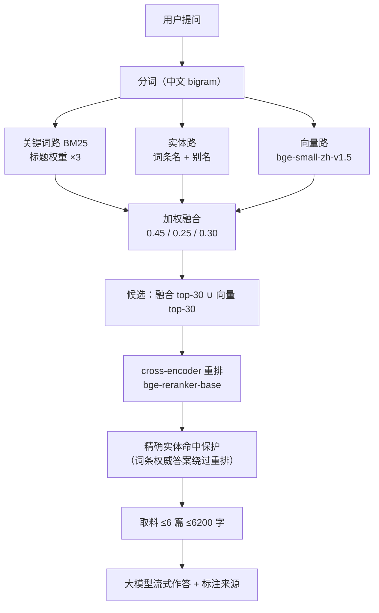

# 多知识库智能问答检索系统（RAG）

把 Markdown 笔记编译成一个**可切换多套知识库的问答页**——
三路混合检索（BM25 + 实体别名 + 向量语义）+ cross-encoder 重排 + 大模型流式回答，
并把「它凭什么答出来的」完整摊开给你看。

> **第一次来？先看 [`使用指南.md`](../使用指南.md)**（仓库根目录）——
> 那里面有安装、放数据、启动的完整步骤和界面说明。本文档偏工程与设计。

---

## 30 秒了解这个仓库

| | |
|---|---|
| **它是什么** | 一套可复用的多知识库 RAG 框架 + 一个可用的问答前端 |
| **核心链路** | 关键词路 + 实体路 + 向量路 → 加权融合 → cross-encoder 重排 → 大模型流式生成 |
| **关键技术** | BM25 bigram 倒排、实体别名解析、bge 向量召回、bge-reranker 精排、Chroma 持久化、FastAPI 双运行时、可解释 trace 面板 |
| **实测效果** | 120 题评测：Hit@1 64.2% → **79.2%**，MRR 0.753 → **0.857** |
| **仓库里有什么** | 代码 + 34 项功能规格 + 9 套自动化测试（82 断言）+ 设计文档 |
| **仓库里没什么** | 知识数据、模型权重、向量索引（都可用脚本重建） |

---

## 极简上手（给 clone 者）

```bash
# 1) 装依赖
pip install -r 检索页/requirements.txt

# 2) 放知识数据：把你的 Markdown 笔记按下面结构放进 检索页/data/worldcup/
#    Cleaned/(笔记)  entity/(实体词条)  concept/(概念词条)  index.md(分类导航)

# 3) 构建检索数据
python 检索页/build/build_data.py

# 4) 起服务，打开即用
cd 检索页 && python serve.py        # 轻量：http://127.0.0.1:8765
cd 检索页 && python server.py       # 完整：三路融合 + 重排（需先装模型）
```

想开向量检索（强烈建议）再加一步：

```bash
python 检索页/build/download_models.py    # 魔搭下载，约 1.3GB，国内免梯子
node   检索页/build/export_docs.js
python 检索页/build/build_vectors.py
```

> 没有自己的语料也能先跑：起服务后页面会自动降级为内置 BM25，检索功能可用。
> 完整步骤、参数说明、降级机制见 [`使用指南.md`](../使用指南.md)。

---

## 三种运行方式

| 方式 | 命令 | 特点 |
|---|---|---|
| 双击 HTML | 打开 `index.html` | 无需服务；`file://` 可用；**大模型通道不可用**（域名未授权），自动降级本地摘要 |
| 本地静态服务 | `python serve.py [端口]` | 默认 8765，自动开浏览器 |
| 完整服务端 | `python server.py` | 三路融合 + 重排 + 流式回答；未就绪时页面自动回退 BM25 |

健康检查：

```
GET /api/health
{"ok":true,"engine":"server","docs":130,
 "models":{"embedding":"bge-small-zh-v1.5 (torch)","reranker":"bge-reranker-base"},
 "vectorDb":{"type":"chroma(persisted) + in-memory index","vectors":1079}}
```

---

## 检索链路



**为什么这么设计**

| 决策 | 理由 |
|---|---|
| 三路融合而非单路 | 关键词擅长专名数字、实体擅长简称别名、向量擅长口语化；互补而非替代 |
| 重排放精排（top-30→重排） | cross-encoder 精度高但慢，全量打分不可行，只对融合后的候选打 |
| 实体精确命中绕过重排 | 实测：搜「梅西」时 cross-encoder 系统性偏向内容丰富的笔记，实体型掉到 40%；加保护后回到 100% |
| 查询走内存索引而非 Chroma | 1037×512 量级，内存点积快于查库；同时规避 chromadb 1.5.9 在 Windows 跨进程读 HNSW 段的 bug |
| 权重文件决定运行时 | 有无 `model.safetensors` 决定走 torch 还是 ONNX，而非「有没有装 torch」——沙箱预装 torch 也能正确选路 |

### 双运行时（按权重文件自动选路）

| | 本地完整版（有 `model.safetensors`） | 轻量部署版（只有 `model.onnx`） |
|---|---|---|
| embedding | torch fp32 | ONNX Runtime（无 torch/CUDA 依赖） |
| 重排 | bge-reranker-base | 停用，按融合分排序 |
| 单次检索 | ~10s（重排占大头） | **~31ms** |
| 依赖 | `requirements.txt` 完整版 | 精简：numpy + onnxruntime |

环境变量 `EMB_BACKEND=onnx` 可强制走轻量路。

---

## 效果：三档实测（同一套 120 题评测集）

| 题型 | 题数 | BM25 基线 Hit@1 | 混合+重排 Hit@1 | Hit@5 | MRR |
|---|---|---|---|---|---|
| 事实数字型 | 40 | 52.5% | **77.5%** | 95.0% | 0.697 → 0.850 |
| 专名实体型 | 30 | 100% | 100% | 100% | 1.000 |
| 通用概念型 | 14 | 71.4% | **85.7%** | **100%** | 0.786 → 0.899 |
| 口语化改写型 | 36 | 44.4% | **61.1%** | **91.7%** | 0.596 → 0.728 |
| **总体** | **120** | 64.2% | **79.2%** | **95.8%** | **0.753 → 0.857** |

| 部署档位 | Hit@1 | Hit@5 | MRR |
|---|---|---|---|
| 纯前端 BM25 + 实体 | 64.2% | 90.0% | 0.753 |
| 服务端融合（ONNX，无重排） | 72.5% | 93.3% | 0.816 |
| 服务端完整（torch + 重排） | **79.2%** | **97.5%** | **0.854** |

> 已知 trade-off：两道「揭幕战」题从第 2 名掉出 top-5——cross-encoder 对内容更丰富的干扰文档打分偏高。

---

## 页面上的两个特色

### 1. 检索过程 trace 面板

答案卡上方折叠面板，7 步摊开：分词 → 关键词路 → 实体路 → 归一化融合 → 相关度闸门 → 取料 → 生成。
每步显示明细，**总耗时与分步耗时**（毫秒 / 秒自动切换单位）。第 5 步未通过会标红并给出拦截原因。

### 2. 检索自检按钮

顶栏一键在浏览器里跑 120 题评测，出 Hit@1/Hit@3/Hit@5/MRR 指标卡 + 分题型表 + 未命中清单，
1 秒左右跑完，**不调用大模型**，判定规则与离线脚本完全一致。

---

## 目录结构

```
仓库根/
├── 使用指南.md          ← 面向使用者的安装/启动/FAQ（先看这个）
├── 设计方案_多库切换.md   多知识库路由设计
└── 检索页/
    ├── index.html      页面（样式与交互全在这一个文件）
    ├── server.py       服务端检索（FastAPI：三路融合 + 重排）
    ├── serve.py        本地静态服务
    ├── requirements.txt
    ├── data/           各库知识数据 ← 自备，不入库
    ├── data.js         构建产物（build_data.py 生成）
    ├── eval_cases.js   构建产物（build_eval_cases.js 生成）
    ├── build/          构建脚本
    │   ├── clean_wiki.py       原始文档 → 标准知识库结构（清洗）
    │   ├── build_data.py       知识库 md → data-<db>.js（含分块）
    │   ├── export_docs.js      data.js → vector/docs.json
    │   ├── build_eval_cases.js 评测集 → eval_cases.js
    │   ├── download_models.py  从魔搭下载 bge embedding / reranker
    │   ├── build_vectors.py    chunk 向量化 → Chroma + vectors.json
    │   ├── export_onnx.py      torch → ONNX（云端轻量版）
    │   └── rerank.py           bge-reranker 候选打分
    ├── tests/          9 套自动化测试 + 评测（见下）
    ├── specs/          34 项功能规格（SpecDD，按状态归档）
    │   └── Done/ Indevelopment/ Abandoned/ Plan/
    └── README.md       本文件
```

> **数据不在仓库里**：`data/`、`LLM Wiki/`、`data*.js`、`vector/` 均为本地产物，
> 已写入 `.gitignore`，用上面的 build 脚本即可生成。

---

## 测试与评测

```bash
# 自测（改完代码建议都跑）
node tests/test_search.js       检索 / 答案 / 渲染 / 边界
node tests/test_llm.js          大模型通道（模拟 SDK 流式）
node tests/test_selfcheck.js    页面自检与离线基线一致
node tests/test_database_switch.js  多知识库切换
node tests/test_concurrent.js   重复提问 / 快速切换的竞态防护
node tests/test_progress_feedback.js 等待期进度反馈
node tests/test_stream_render.js 流式渲染按帧节流

# 评测
node tests/eval.js              120 题 → eval_report.md
node tests/eval_v2.js stage1    混合检索评测 + 导出重排候选
python build/rerank.py          reranker 打分（CPU 约 20 分钟）
node tests/eval_v2.js final     应用重排，出最终指标
node tests/eval_backend.js      服务端回归（BACKEND_URL 可指向线上）
node tests/compare_baselines.js eval_baseline_clean.json eval_baseline_v2.json
```

---

## 文档索引

| 文档 | 内容 |
|---|---|
| [`使用指南.md`](../使用指南.md) | 安装、准备语料、启动、界面功能、FAQ |
| [`开发约束.md`](./开发约束.md) | 开发前必读（含 R-01：降级必须先确认方案与影响） |
| [`设计方案_多库切换.md`](./设计方案_多库切换.md) | 多库路由设计 |
| [`specs/README.md`](./specs/README.md) | 34 项功能规格，含验收标准与判定命令 |
